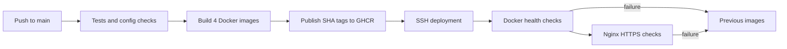

# Docker + Nginx CI/CD

Repository: worknai009/Business_Experts. Destination VPS: **76.13.185.120**.
This is the current automated deployment path. The older Caddy files remain available for manual deployments; do not run both proxy setups on the same ports.



## What the workflow does

- Pull requests: install locked dependencies, run backend tests, build all frontends, check Compose/Nginx configuration, test rollback logic and build Docker images without publishing/deploying.
- Push to main: run those checks, publish four images to GHCR tagged with the exact commit SHA, and deploy when DEPLOY_ENABLED is true.
- Manual run: choose prepare to start/check applications before DNS cutover, or deploy for the full HTTPS rollout.
- Failed rollout: attempt to restore previous images and the four managed Nginx files. The workflow still fails visibly. A failed first deployment is stopped because there is no prior release.

This is a single-VPS replacement deployment, so application container replacement can cause a brief interruption. Rollback restores application images/configuration; it does not undo database writes or edits to shared files/secrets.

## Runtime layout

| Path | Purpose |
| --- | --- |
| /opt/business-experts/releases/COMMIT_SHA | Deployment scripts and Compose/Nginx config for that commit |
| /opt/business-experts/shared/.env | Verified production credentials; never uploaded by Actions |
| /opt/business-experts/shared/uploads | Persistent existing uploads |
| /opt/business-experts/shared/ai-data/site_content.json | Persistent BusinessAI CMS content |
| /opt/business-experts/shared/state/current.env | Last verified image prefix/tag; contains no application credentials |
| /etc/nginx/conf.d/business-experts.conf | Four domain routes |
| /etc/letsencrypt/live/businessexperts.asia | SAN certificate covering the four hosts |

Production runs four application containers and uses the existing Atlas database. It does not create a MongoDB container, seed demo data, or reset/create administrator users.
All app ports bind to loopback only: API 5000, public 5180, admin 5181, analytics 5173. Only host Nginx exposes HTTP/HTTPS. Nginx preserves /api and /ai-api paths.

## 1. Obtain VPS access

Open the hosting provider's VPS panel and find its operating system and SSH/terminal section. You need the SSH username, port, and a working key. Do not guess or replace the server's existing credentials.

The setup script detects Ubuntu/Debian and supports x86_64. The workflow builds linux/amd64 images. This initial setup/deployment expects a root SSH account because it installs/reloads host Nginx. A dedicated automation account requires equivalent, deliberately configured privileges.

Keep the old VPS running until the destination is verified.

## 2. Prepare Docker and Nginx on the destination

Upload the deploy directory and root .env.example privately to a temporary source directory on the new VPS (or clone the private repository using your existing authorized access). Then run from that directory:

```bash
sudo bash deploy/setup-vps.sh --prepare
```

The script detects the OS, installs Docker/Compose and Nginx/Certbot, creates persistent directories, and installs an HTTP ACME challenge site. It refuses to proceed if another proxy owns ports 80/443. It leaves unrelated Nginx sites in place.

Privately edit /opt/business-experts/shared/.env with the **old server's real** MONGODB_URI, JWT_SECRET, email/Cloudinary/AI settings. Keep the exact database name/options and existing signing key where production validation permits it. The newly generated local .env is not a verified copy of these settings.

Add the destination's outbound public IP to the existing Atlas project's database IP access list. Transfer current uploads into shared/uploads and the old AI content file into shared/ai-data/site_content.json **before** starting the new backend. Paths on the old server are described in MIGRATION.md. If the old app never had custom AI content, leave that file absent to initialize the shipped defaults.

```bash
sudo chmod 600 /opt/business-experts/shared/.env
sudo chown -R 1000:1000 /opt/business-experts/shared/uploads /opt/business-experts/shared/ai-data
```

Take an Atlas backup/export and a copy of local files/environment before cutover. Pause CMS edits/uploads for the final file synchronization. No database export/import is needed merely to point the new application at the same Atlas database.

## 3. Configure GitHub Actions

In the repository, open Settings -> Secrets and variables -> Actions.
Create repository secrets (or secrets in the production environment):

| Secret | Value |
| --- | --- |
| VPS_HOST | 76.13.185.120 |
| VPS_USER | Actual authorized SSH username; setup currently expects root |
| VPS_PORT | Actual SSH port, optional if 22 |
| VPS_SSH_KEY | Dedicated deployment SSH private key; matching public key belongs in the server's authorized_keys |
| VPS_KNOWN_HOSTS | Verified SSH host-key entry for this server/port |

Verify the server host-key fingerprint through the provider console or another trusted channel. For a custom SSH port the known-hosts entry normally uses [76.13.185.120]:PORT. The workflow uses strict host-key verification and does not blindly trust ssh-keyscan output.

If Actions reports Permission denied (publickey,password), the VPS rejected the login identity. Run Actions -> Check VPS SSH access -> Run workflow to test this separately, without building images or deploying. Its SSH key step derives the public key matching VPS_SSH_KEY and prints it as DEPLOY_PUBLIC_KEY, plus its fingerprint. Install that PUBLIC key on the new server for the exact account configured in VPS_USER; a key installed only on the old VPS will not authorize access to the new one. The private key is never printed. The workflow also rejects invalid or interactively encrypted private keys and normalizes Windows line endings.

From the hosting provider's browser terminal, log in as the intended deployment user and run the following after replacing the placeholder with that public-key line (without the DEPLOY_PUBLIC_KEY= prefix):

```bash
whoami
install -d -m 700 "$HOME/.ssh"
touch "$HOME/.ssh/authorized_keys"
chmod 600 "$HOME/.ssh/authorized_keys"
PUBLIC_KEY='PASTE_THE_COMPLETE_PUBLIC_KEY_FROM_ACTIONS_HERE'
grep -qxF "$PUBLIC_KEY" "$HOME/.ssh/authorized_keys" || printf '\n%s\n' "$PUBLIC_KEY" >> "$HOME/.ssh/authorized_keys"
```

Set VPS_USER to the verified account printed by whoami. Current deployment expects root privileges for Nginx; do not assume a different user's home directory is interchangeable. If login is still denied, inspect the server's SSH authentication logs, ownership and effective PubkeyAuthentication/PermitRootLogin policy. Changing SSH access policy is a separate server decision; the workflow does not weaken it. Re-run the failed job after access is corrected.

No persistent registry PAT is required: the workflow publishes/pulls the repository's GHCR images using its GITHUB_TOKEN with job-specific package permissions. That token is passed over SSH on stdin and Docker uses a temporary credential directory, which is removed at the end. Existing GHCR packages must grant this repository Actions access if they were created separately.

Repository variables:

| Variable | Value |
| --- | --- |
| DEPLOY_ENABLED | true only after server access, production environment and migrated files are ready |
| VITE_GOOGLE_CLIENT_ID | Optional public OAuth client ID for the analytics frontend |

Until DEPLOY_ENABLED is true, builds/tests/publishing can run, while the VPS deploy job stays skipped. Never put application database passwords or private keys in VITE variables.

## 4. Stage applications, then switch DNS

After configuring secrets and enabling deployment, go to Actions -> CI and production deployment -> Run workflow on main -> mode prepare.
This pulls the commit's images, validates the production environment, starts all four applications and checks their health. It does not modify Nginx or perform public HTTPS checks.

After verifying the containers and migrated files, update A records for @, admin, analytics and api to **76.13.185.120**. Keep/redirect other previously active domains separately where required. Allow inbound TCP 80/443 and the actual SSH port in the provider/host firewall. Add AAAA only if IPv6 also reaches this VPS.

Issue the certificate from the source directory used for setup, replacing the example address with your real TLS contact email:

```bash
sudo bash deploy/setup-vps.sh your-real-email@example.com
```

Certbot obtains one certificate for all four names, installs the HTTPS Nginx config, and enables its renewal timer. A renewal deploy hook tests/reloads Nginx after a successful renewal.

Then run the workflow again in deploy mode. Future pushes to main use deploy mode automatically. During the initial staging window, avoid an automatic deploy before certificates exist; it will fail its certificate preflight rather than starting the full rollout.

## Verification

The deploy script checks container readiness and verifies HTTPS **against local Nginx using curl --resolve**, preserving certificate/Host verification. This prevents cached DNS from accidentally verifying the old VPS. It checks frontend HTML and JSON API response types on all four domains.

Also verify externally: public navigation/media, administrator login, BusinessAI content saving, and OTP delivery. Existing application limitations listed in README.md are separate from the delivery pipeline.

```bash
docker compose --project-name business-experts-prod \
  --env-file /opt/business-experts/shared/.env \
  -f /opt/business-experts/releases/COMMIT_SHA/deploy/compose.production.yml ps
```

For ad-hoc Compose commands export IMAGE_PREFIX, IMAGE_TAG and SHARED_DIR first; the last verified prefix/tag are in shared/state/current.env. Do not print the production .env into CI logs.

## Backups, retention and recovery

Use the existing Atlas snapshot/export process. Back up shared/.env, shared/uploads and shared/ai-data privately, and copy backups outside this VPS. The older backup.sh script is for the managed local-MongoDB deployment, not this Atlas pipeline.

Keep the current and previous release directories/images available for rollback. Do not run docker system prune -a during deployment. Review old unreferenced releases/images periodically to manage disk usage. The pipeline does not delete production volumes or restore database snapshots automatically.

On rollout failure, inspect Actions logs, Docker container logs and nginx -t output. The state file stays on the last verified release if rollback is triggered. If automatic recovery fails, the workflow reports that explicitly and manual intervention is required. Keep the old VPS available through initial cutover as an additional routing rollback option.

## References

- [GitHub: publishing Docker images](https://docs.github.com/en/actions/tutorials/publish-packages/publish-docker-images)
- [GitHub: container registry authentication](https://docs.github.com/en/packages/working-with-a-github-packages-registry/working-with-the-container-registry)
- [Docker: Ubuntu installation](https://docs.docker.com/engine/install/ubuntu/)
- [Nginx proxy module](https://nginx.org/en/docs/http/ngx_http_proxy_module.html)
- [Certbot: webroot and renewal hooks](https://eff-certbot.readthedocs.io/en/stable/using.html)
